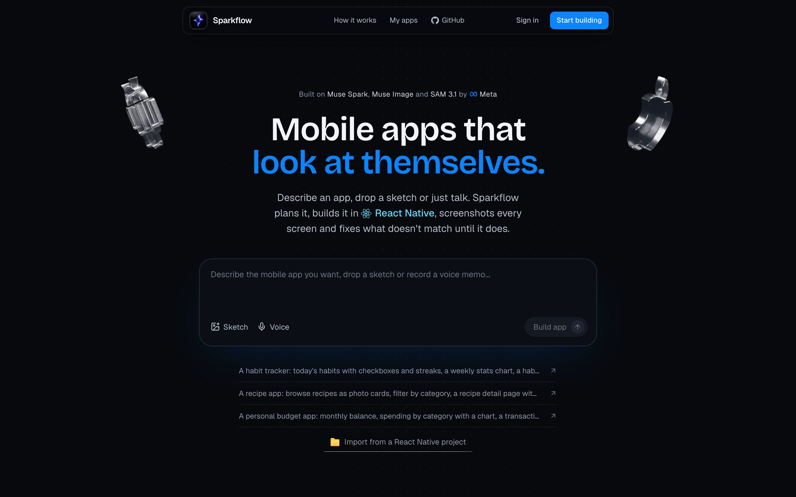
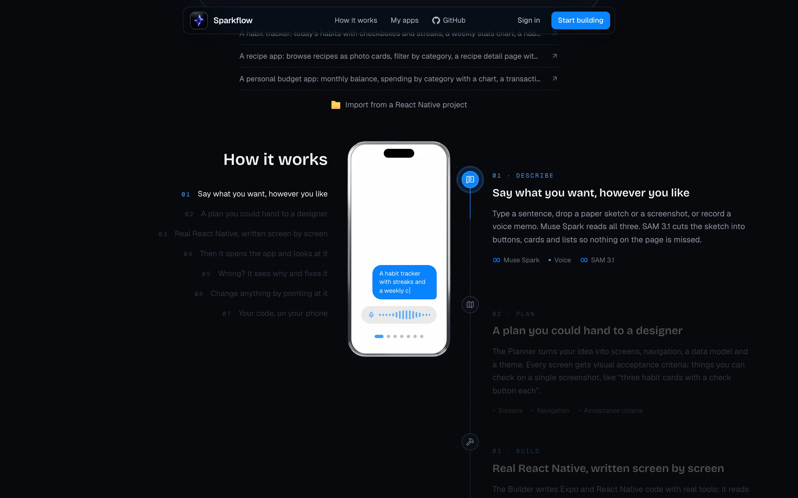
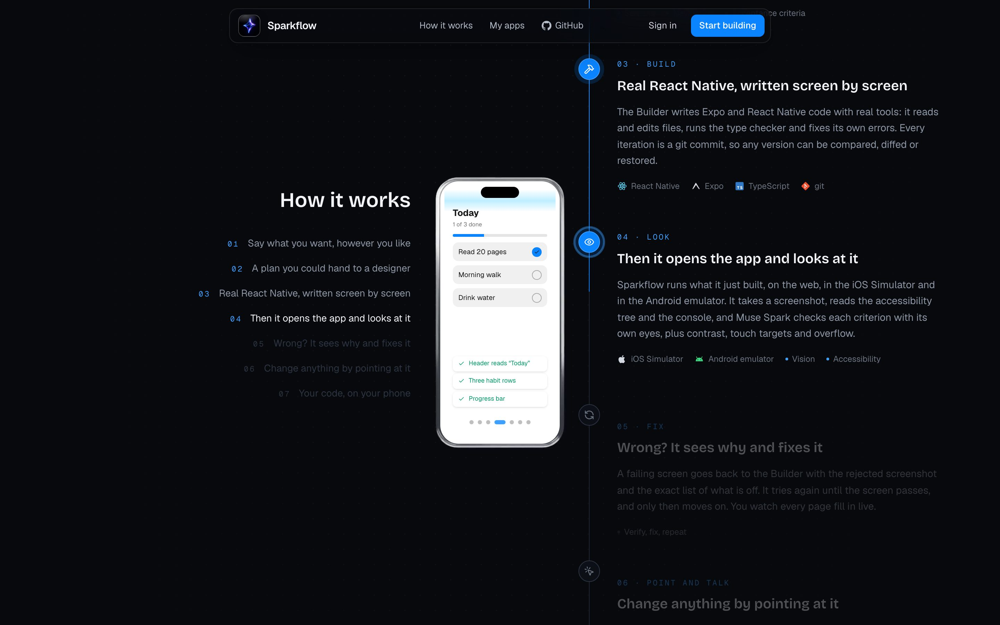
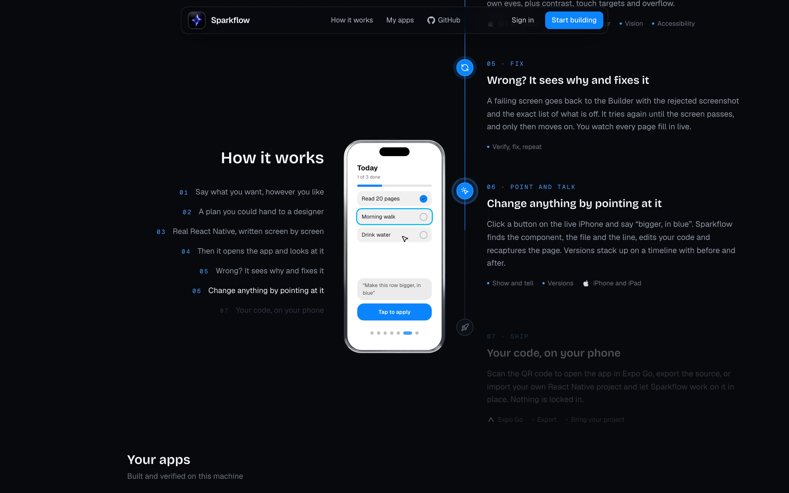

<!-- <CENTERED SECTION FOR GITHUB DISPLAY> -->

<div align="center">

<a href="https://sparkflow-ai.web.app"></a>

# Sparkflow

**Mobile apps that look at themselves.**

[](https://sparkflow-ai.web.app)

</div>

> Describe a mobile app, drop a sketch or just talk. Sparkflow plans it, builds it in React Native, opens it in the iOS Simulator and the Android emulator, screenshots every screen and fixes what doesn't match until it does.

> [!TIP]
>
> | [](https://sparkflow-ai.web.app) | The site is hosted; the builds run on your Mac or Linux machine. |
> | :----- | :----- |
> | [](#quick-start) | `curl -fsSL https://sparkflow-ai.web.app/install.sh \| bash`, then `sparkflow`. |

<div align="center">

[](https://github.com/Antoinegtir/sparkflow/releases)
[](https://github.com/Antoinegtir/sparkflow/actions)
[](https://github.com/Antoinegtir/sparkflow/stargazers)
[](LICENSE)

[](https://ai.meta.com)
[](https://reactnative.dev)
[](https://expo.dev)
[](https://www.typescriptlang.org)
[](https://nextjs.org)

</div>

<!-- </CENTERED SECTION FOR GITHUB DISPLAY> -->

| Describe | Look |
|:---:|:---:|
|  |  |

| Point and talk |
|:---:|
|  |

## Contents

- [Overview](#overview)
  - [How it works](#how-it-works)
- [Features](#features)
- [Quick start](#quick-start)
  - [Prerequisites](#prerequisites)
  - [The `sparkflow` command](#the-sparkflow-command)
  - [Where your apps live](#where-your-apps-live)
- [Development](#development)
  - [Scripts](#scripts)
  - [Releases and deploys](#releases-and-deploys)
- [Architecture](#architecture)
- [License](#license)

## Overview

**Sparkflow** turns an idea into a native mobile app that checks its own work. You write a sentence, drop a paper sketch or a screenshot, or record a voice memo; it returns a real Expo project, verified screen by screen, that you can open on your phone, export or keep editing.

| Logo | Built on | Role |
|:---:|---|---|
|  | **Muse Spark** · **SAM 3.1** by Meta | Reads text, sketches and voice; plans the app; judges each screenshot against its criteria. SAM cuts sketches into buttons, cards and lists. |
|  | **React Native** | The code it writes: real components, no web view. |
|  | **Expo** · Expo Router | The project template, navigation, Expo Go and the dev client. |
|  | **iOS Simulator** | Where the app runs and gets looked at, with its accessibility tree. |
|  | **Android emulator** | Same, on Android, through adb and uiautomator. |

### How it works

| Step | | What happens |
|:---:|---|---|
| 01 | **Describe** | Say what you want, however you like: text, sketch, screenshot or voice. |
| 02 | **Plan** | The Planner turns it into screens, navigation, a data model, a theme, and visual acceptance criteria for every screen. |
| 03 | **Build** | The Builder writes Expo and React Native code with real tools: it edits files, runs the type checker and fixes its own errors. Every iteration is a git commit. |
| 04 | **Look** | Sparkflow runs what it built on the web, in the iOS Simulator and in the Android emulator, screenshots it, reads the accessibility tree and the console. |
| 05 | **Fix** | A screen that fails goes back to the Builder with the rejected screenshot and the exact list of what is off, until it passes. |
| 06 | **Point and talk** | Click anything on the live phone and say “bigger, in blue”: Sparkflow finds the component, the file and the line, and edits it. |
| 07 | **Ship** | Scan the QR code with Expo Go, export the source, or import your own React Native project and let Sparkflow work on it in place. |

## Features

- **Three ways in**: a prompt, a sketch or a screenshot, a voice memo.
- **Visual verification**: every screen is checked on its screenshot, plus contrast, touch targets and overflow.
- **Live devices**: the iOS Simulator and Android emulators stream into the browser, booted from the device menu; tap, type, rotate, switch light and dark.
- **Point and edit**: select an element on the live phone and ask for a change; the IDE jumps to its file and line.
- **An IDE for the whole app**: every page on a canvas, the code, assets, history with diffs and restore, accessibility scores.
- **Your apps everywhere**: signed in with GitHub or Google, your apps are saved to your account and listed even when your computer is off.
- **GitHub, Finder, VS Code**: create the repository with the GitHub CLI and push, or open the project folder in one click.
- **Bring your project**: import an existing Expo app; Sparkflow drives it in place.

## Quick start

```bash
curl -fsSL https://sparkflow-ai.web.app/install.sh | bash
sparkflow
```

The installer checks your machine, installs what's missing without sudo, downloads the latest release (checksum verified) into `~/.sparkflow` and adds the `sparkflow` command. The first start asks for your Muse Spark API key and where your apps should live; without a key, a demo mode builds a sample app.

`sparkflow` starts the server, opens a Cloudflare tunnel and opens [sparkflow-ai.web.app](https://sparkflow-ai.web.app) connected to your computer.

### Prerequisites

| | Needed for |
|---|---|
| macOS or Linux | Running the server |
| Node 20+, git | Everything (Node is installed for you if missing) |
| Xcode | The iOS Simulator view (command line tools alone are enough to build) |
| Android Studio | The Android emulator view (`ANDROID_HOME` or `~/Library/Android/sdk`) |
| cloudflared, watchman | The tunnel and Metro (installed for you if missing) |
| GitHub CLI (`gh`) | Optional: creating repositories from the IDE |

### The `sparkflow` command

| Command | Does |
|---|---|
| `sparkflow` | Start the server, the tunnel and the site |
| `sparkflow doctor` | Check the machine and the installation |
| `sparkflow update [vX.Y.Z]` | Install the latest release (or a given one); nothing happens when you're up to date |
| `sparkflow version` | Print the installed version |
| `sparkflow uninstall [--all]` | Remove Sparkflow, keeping your apps; `--all` also deletes `~/.sparkflow` (settings, and apps kept there) |

### Where your apps live

You pick the folder at the first start (for example `~/Documents/apps`; it's `SPARKFLOW_DATA_DIR` in `~/.sparkflow/.env`). Each app is a plain Expo project with its own git history:

```
~/Documents/apps/
├── wander/          ← an app: open it in VS Code, run it with Expo
├── habitly/
└── .sparkflow/      ← Sparkflow's own files: history, screenshots
```

## Development

```bash
npm install
npm run setup      # the Expo template's dependencies and Playwright's Chromium
cp .env.example .env   # MODEL_API_KEY=… (a scripted mock agent runs without it)
npm run dev
```

### Scripts

| Script | |
|---|---|
| `npm run dev` | The app and its API on localhost |
| `npm run remote` | Same as `sparkflow`, from this checkout |
| `npm test` | Unit tests (Vitest) |
| `npm run typecheck` | TypeScript |
| `npm run smoke` | One full build with the mock agent and the local sandbox |
| `npm run eval` | The prompts in `eval/prompts.json`, results in `eval/results/` |

### Releases and deploys

- `npm run release -- patch` (or `minor`, `major`, `1.2.3`) bumps the version, tags `vX.Y.Z` and pushes. The `Release` workflow builds the server and publishes `sparkflow-vX.Y.Z.tar.gz` and its `.sha256` on GitHub Releases, which `install.sh` and `sparkflow update` download.
- `npm run deploy` publishes the site: a static export, then Firebase Hosting.

## Architecture

```
 sparkflow-ai.web.app (static, Firebase)          your computer (sparkflow)
 ┌──────────────────────────────┐   tunnel   ┌────────────────────────────────────┐
 │ Landing · My apps · IDE      │ ─────────▶ │ Next.js API on :3002               │
 │ Firebase Auth, Firestore,    │  /api, SSE │  Planner → Builder → Verifier      │
 │ Cloud Storage (saved apps)   │            │  Expo sandboxes, Metro, Playwright │
 └──────────────────────────────┘            │  iOS Simulator · Android emulator  │
                                             └────────────────────────────────────┘
```

| Path | |
|---|---|
| `app/` | The site and the IDE (Next.js App Router), and the API routes |
| `lib/agent/` | The orchestrator, the Planner, Builder and Verifier, the project store |
| `lib/sandbox/` | Running apps locally: sandboxes, Metro, the inspector |
| `lib/web/` | Browser-side: the backend shim, devices, Firebase |
| `templates/expo-base/` | The Expo template every app starts from |
| `templates/demo/` | Wander, the demo app every user finds in My apps |
| `scripts/` | Install, onboarding, release, static build |

## License

[MIT](LICENSE) © 2026 Antoine Gonthier.

File icons from [Material Icon Theme](https://github.com/material-extensions/vscode-material-icon-theme) (MIT). Apple and the Apple logo are trademarks of Apple Inc. Android robot © Google, CC BY 3.0. Sparkflow is not affiliated with Apple, Google or Meta.
