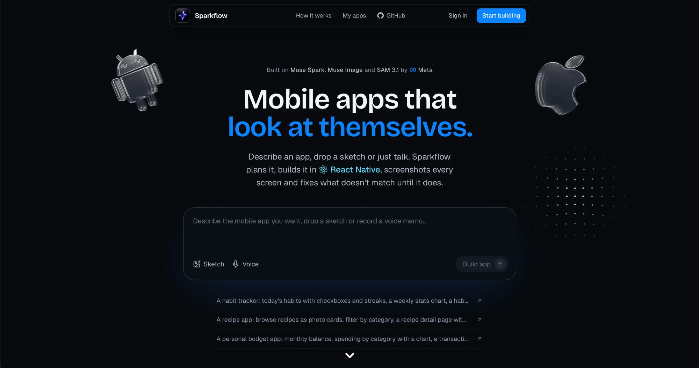
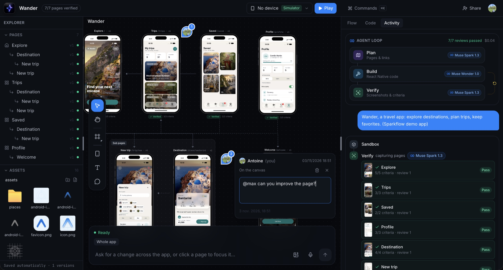
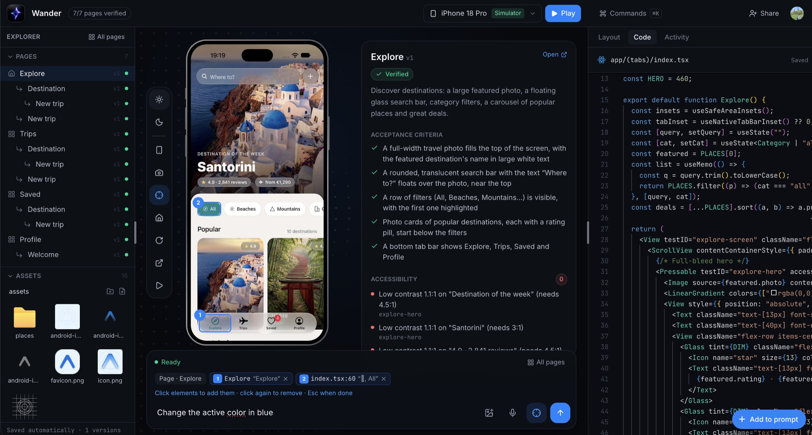
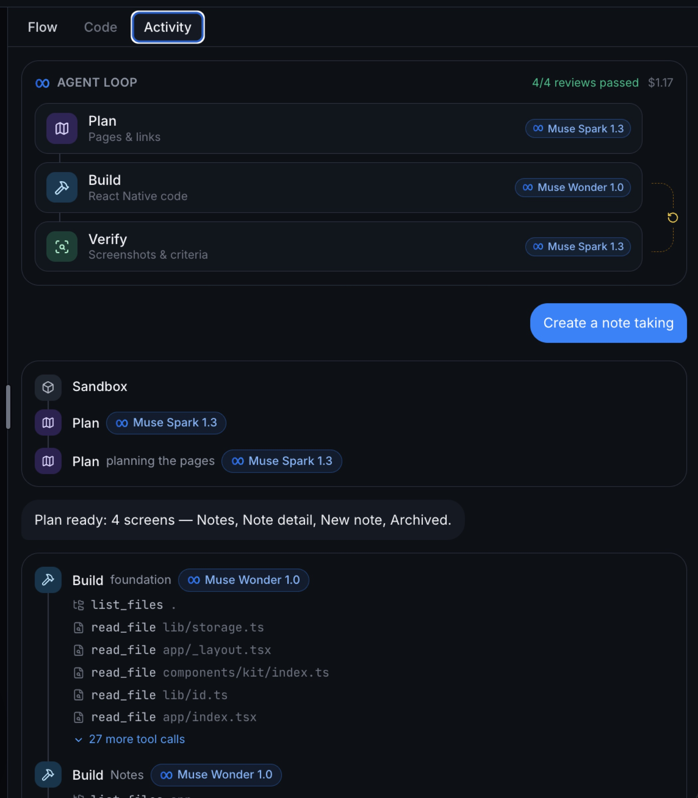
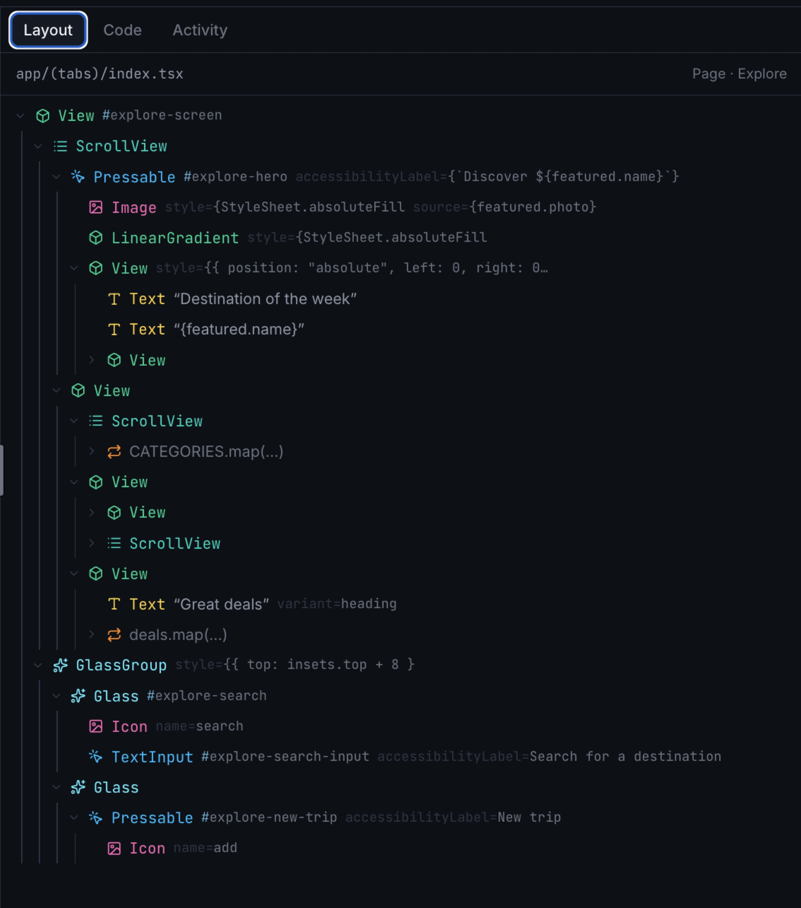
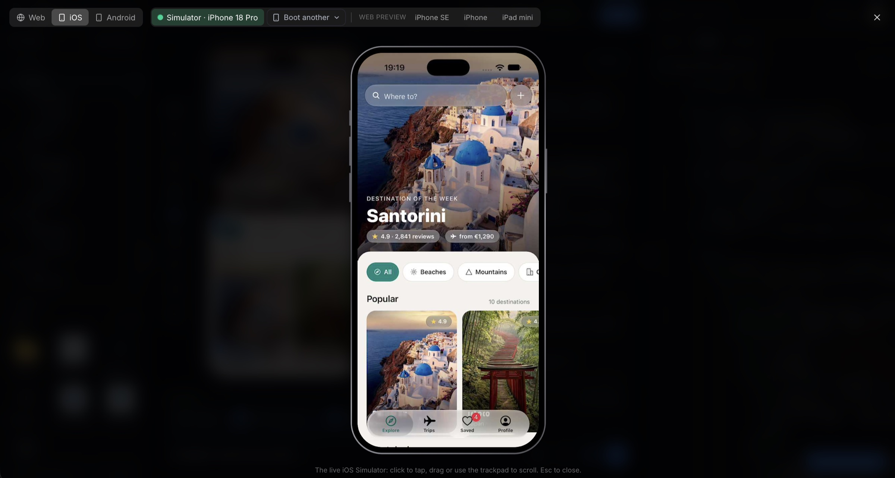
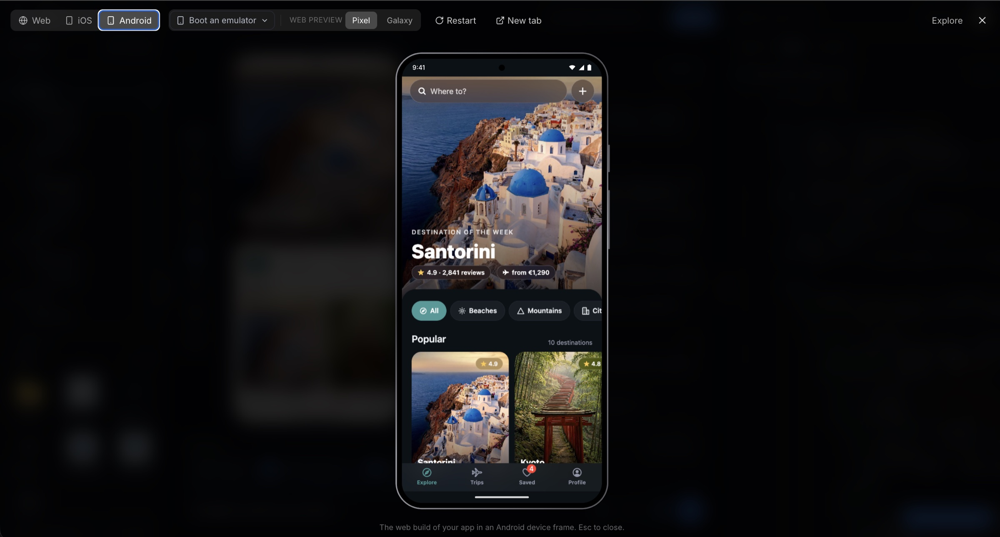
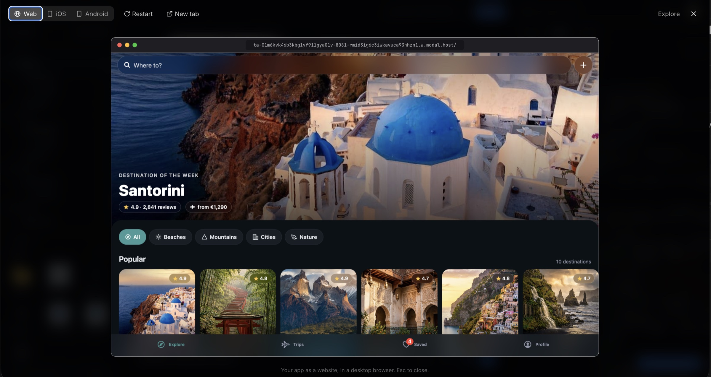

<!-- <CENTERED SECTION FOR GITHUB DISPLAY> -->

<div align="center">

[](https://sparkflow-ai.web.app)

</div>

> Describe a mobile app, drop a sketch or just talk. Sparkflow plans it, builds it in React Native, screenshots every screen, checks it against the plan and fixes what doesn't match. Then it opens the app in the iOS Simulator and the Android emulator.

> [!TIP]
>
> Nothing to install to try it: sign in and build in the cloud.
>
> [](https://sparkflow-ai.web.app) | Build in the cloud: the app in a web preview and on your phone with Expo Go. |
> | :-----| :----- |
> [](#quick-start) | For the real iOS Simulator and Android emulator: `curl -fsSL https://sparkflow-ai.web.app/install.sh \| bash`, then `sparkflow`. |
> [](#built-during-the-hackathon) | Built during the Meta Global AI Developer Hackathon for **Build for Your World**, on Muse Spark, Muse Wonder, Muse Image, Muse Voice Transcribe and SAM 3.1. |
> [](https://github.com/Antoinegtir) | Follow [@Antoinegtir](https://github.com/Antoinegtir) on GitHub for more projects. |

<div align="center">

[](https://github.com/Antoinegtir/sparkflow/releases)
[](https://github.com/Antoinegtir/sparkflow/actions)
[](https://github.com/Antoinegtir/sparkflow/commits/main)
[](https://github.com/Antoinegtir/sparkflow/stargazers)
[](https://github.com/Antoinegtir/sparkflow/issues)
[](LICENSE)

[](#architecture)

</div>

<!-- </CENTERED SECTION FOR GITHUB DISPLAY> -->

| Every page on one canvas, each verified by the agent | Point at an element, say what to change |
|:---:|:---:|
|  |  |

| The agent loop: Muse Spark plans, Muse Wonder builds, Muse Spark verifies | The page's native layout tree |
|:---:|:---:|
|  |  |

| Play on the iOS Simulator | Play on the Android emulator | Play on the web |
|:---:|:---:|:---:|
|  |  |  |

> **Try it in a minute: open [sparkflow-ai.web.app](https://sparkflow-ai.web.app), sign in with GitHub or Google, and open the Wander demo or describe your own app. Runs are unlimited through the judging.**

## Overview

**Sparkflow** turns an idea into a native mobile app that checks its own work. You write a sentence, drop a paper sketch or a screenshot, or just say it; it returns a real Expo project, verified screen by screen, that you can open on your phone, export or keep editing.

Sparkflow answers the **Build for Your World** problem statement (Indie Developer track): it brings Meta's models into mobile app development, so that describing an app is enough to get a native one, looked at and checked screen by screen, that you can hold on your phone the same day.

| Logo | Built on | Role |
|:---:|---|---|
|  | **Muse Spark** · **Muse Wonder** · **Muse Image** · **Muse Voice Transcribe** · **SAM 3.1** by Meta | Every step of the agent loop: planning, writing the code, judging each screenshot, drawing the assets, reading sketches, hearing what you say. See [Meta models](#meta-models). |
|  | **React Native** | The code it writes: real components, no web view. |
|  | **Expo** · Expo Router | The project template, navigation, Expo Go and the dev client. |
|  | **Google Cloud Run** | The cloud server, in Europe and the US, for everyone without a Mac. |
|  | **Modal** | One sandbox per app in the cloud: Expo, Metro and the captures. |
|  | **iOS Simulator** | Where the app runs and gets looked at, with its accessibility tree. |
|  | **Android emulator** | Same, on Android, through adb and uiautomator. |

### How it works

| Step | | What happens |
|:---:|---|---|
| 01 | **Describe** | Say what you want, however you like: text, sketch, screenshot or voice. |
| 02 | **Plan** | The Planner turns it into screens, navigation, a data model, a theme, and visual acceptance criteria for every screen. |
| 03 | **Build** | The Builder writes Expo and React Native code with real tools: it edits files, runs the type checker and fixes its own errors. Every screen version and every change is a git commit. |
| 04 | **Look** | Sparkflow opens each screen in a web preview (Playwright), screenshots it and reads its accessibility tree and console. On a Mac it also captures every page in the iOS Simulator and the Android emulator. |
| 05 | **Fix** | A screen that fails goes back to the Builder with the rejected screenshot and the exact list of what is off, up to three attempts by default (`SPARKFLOW_MAX_ATTEMPTS`); a screen that still fails is marked unverified. |
| 06 | **Point and talk** | Click anything on the live phone and say “bigger, in blue”: Sparkflow finds the component, the file and the line, and edits it. |
| 07 | **Ship** | Scan the QR code with Expo Go, export the source, or import your own React Native project and let Sparkflow work on it in place. |

## Contents

- [Overview](#overview)
  - [How it works](#how-it-works)
- [Meta models](#meta-models)
- [Built during the hackathon](#built-during-the-hackathon)
- [Features](#features)
- [Getting started](#getting-started)
  - [Quick Start](#quick-start)
  - [Cloud or Mac](#cloud-or-mac)
  - [Sharing an app](#sharing-an-app)
- [Architecture](#architecture)
- [Reference](#reference)
  - [Prerequisites](#prerequisites)
  - [The `sparkflow` command](#the-sparkflow-command)
  - [Where your apps live](#where-your-apps-live)
  - [Cloud quotas](#cloud-quotas)
  - [Supported Platforms](#supported-platforms)
- [Development](#development)
  - [Development Setup](#development-setup)
  - [Scripts](#scripts)
  - [Releases and deploys](#releases-and-deploys)
- [Contributing](#contributing)
- [Acknowledgments](#acknowledgments)
- [License](#license)

## Meta models

Sparkflow is an agent loop where each step is a Meta model, called through the [Meta Model API](https://llama.developer.meta.com). The IDE shows which model does what, live, in the **Activity** panel and the prompt bar.

```
 prompt · sketch · screenshot · PDF · voice
            │
            ▼
   ┌─────────────────┐   pages, navigation, data model, theme,
   │  PLAN           │   acceptance criteria for every page
   │  Muse Spark 1.3 │◀── SAM 3.1 segments an attached sketch first
   └────────┬────────┘
            ▼
   ┌─────────────────┐   edits files, runs the type checker, fixes its errors,
   │  BUILD          │   one git commit per iteration
   │  Muse Wonder 1.0│──▶ Muse Image 1.0 draws icons, photos, splash screens
   └────────┬────────┘
            ▼
   ┌─────────────────┐   screenshots every page in the web preview (Playwright),
   │  VERIFY         │   reads the accessibility tree and the console, judges
   │  Muse Spark 1.3 │   each page against its criteria
   └────────┬────────┘
     passes │ fails ─────▶ back to BUILD with the rejected screenshot
            ▼               and the exact list of what is off
     verified app
```

| Model | Where | What it does in Sparkflow |
|---|---|---|
| **Muse Spark 1.3** | Planner, Verifier | Reads the request (text, sketch, screenshot, PDF), writes the plan and the per-page acceptance criteria; then looks at each screenshot and returns a verdict with what to fix. Multimodal in both directions of the loop. |
| **Muse Voice Transcribe 1.0** | Dictation in every prompt box | Turns what you say into text while you talk, through its realtime API ([`lib/agent/meta.ts`](lib/agent/meta.ts)); the audio-capable Muse Spark 1.2 (`MUSE_AUDIO_MODEL`) takes over if it can't be reached. |
| **Muse Wonder 1.0** | Builder | Writes the Expo and React Native code with tools (read, edit, type-check, generate assets), and fixes what the Verifier rejects. |
| **Muse Image 1.0** | Builder tool `generate_image` | App icons, splash screens, photos and illustrations, written straight into the project's assets. |
| **SAM 3.1** | Before planning, on an attached image | Cuts an attached sketch or screenshot into its parts (buttons, cards, lists) before the Planner runs, so the plan follows the drawing. |

Code: [`lib/agent/roles.ts`](lib/agent/roles.ts) (the loop's roles), [`lib/agent/meta.ts`](lib/agent/meta.ts) (Muse Image, SAM, Muse Voice Transcribe), [`lib/agent/llm/`](lib/agent/llm) (the Model API client), [`lib/shared/models.ts`](lib/shared/models.ts) (which model each step uses).

## Built during the hackathon

Sparkflow was started at the kickoff of the Meta Global AI Developer Hackathon (first commit October 26, 2026). The [commit history](https://github.com/Antoinegtir/sparkflow/commits/main) shows it day by day.

| Area | What was built |
|---|---|
| Agent loop | Planner, Builder and Verifier on Meta models, the fix loop, per-page acceptance criteria, visual and accessibility checks |
| Multimodal input | Prompts with sketches, screenshots, PDFs, HEIC photos and dictation (Muse Voice Transcribe); SAM segmentation; Muse Image assets |
| IDE | The canvas of pages and links, live devices, point-and-edit, code editor, layout tree, asset manager, history with diffs and restore, the Activity view of the loop |
| Cloud | Sparkflow without installing anything: Cloud Run in Europe and the US, each app in its own Modal sandbox with a live web preview and Expo Go |
| Mac and cloud together | The `sparkflow` CLI; the cloud's apps opened in the Mac's iOS Simulator and Android emulator, loading their code from the cloud |
| Sharing | Invite links with roles, in the cloud and from a Mac, comments on the canvas |
| Ship | Release builds, TestFlight and Google Play uploads with fastlane, GitHub push |

## Features

- **Three ways in** - a prompt, a sketch or a screenshot (PNG, JPEG, WebP, GIF; HEIC and PDF with Sparkflow on a Mac), or dictation: your words appear as you speak
- **Visual verification** - every screen is checked on its screenshot against its own criteria, plus contrast, touch targets and overflow
- **Nothing to install** - build in the cloud: each app gets its own sandbox, a live web preview and an Expo Go link
- **Real devices when you want them** - with `sparkflow` on a Mac, the iOS Simulator and Android emulators stream into the browser, booted from the device menu; a cloud app opens there too, loading its code from the cloud
- **Point and edit** - select an element on the live phone and ask for a change; the IDE jumps to its file and line
- **An IDE for the whole app** - every page on a canvas with its links, the code, assets, layout tree, history with diffs and restore, accessibility scores, and the agent at work in Activity
- **One source, cloud and Mac** - an app moves between the cloud and your Mac with its git history, pages and screenshots
- **Share with friends** - invite links with a role (view, comment, edit), in the cloud or from your Mac
- **GitHub, Finder, VS Code** - create the repository with the GitHub CLI and push, or open the project folder in one click
- **Ship** - a native Release build with the app's own name and bundle ID, or a fastlane upload to TestFlight and Google Play's internal track, with credentials kept on your computer
- **Bring your project** - import an existing Expo app; Sparkflow drives it in place

## Getting started

### Quick Start

Nothing to install: open [sparkflow-ai.web.app](https://sparkflow-ai.web.app), sign in with GitHub or Google, and build in the cloud.

For the real iOS Simulator and Android emulator, run Sparkflow on your computer:

```bash
curl -fsSL https://sparkflow-ai.web.app/install.sh | bash
sparkflow
```

The installer checks your machine, installs what's missing without sudo, downloads the latest release (checksum verified) into `~/.sparkflow` and adds the `sparkflow` command. The first start asks for your Muse Spark API key and where your apps should live; without a key, a demo mode builds a sample app.

`sparkflow` starts the server and a Cloudflare tunnel, and connects [sparkflow-ai.web.app](https://sparkflow-ai.web.app) to your computer: on a Mac the site opens by itself the first time; after that an open Sparkflow tab finds it.

### Cloud or Mac

| | Cloud (default) | Your Mac (`sparkflow`) |
|---|---|---|
| Install | Nothing | One command |
| Where the app runs | Its Modal sandbox: web preview, Expo Go | Local sandbox: web preview, Expo Go, iOS Simulator, Android emulator |
| Real simulators | Yes, once `sparkflow` runs: the device menu lists them and loads the app from the cloud | Yes |
| Release builds and store uploads | No | Yes |
| Your Muse Spark key | Sparkflow's | Yours, kept on your computer |

An app is one source on both sides: opening it on the Mac brings the cloud's newer version first, and a run on the Mac sends the new code back to the cloud.

### Sharing an app

**Share** in the IDE makes an invite link with a role (view, comment or edit), an expiry and an optional single use. A friend opens it, signs in with GitHub or Google, and gets that app only. In the cloud they need nothing else; from a Mac, the app is reached through its tunnel while `sparkflow` runs, and a read-only copy of its pages stays available when the Mac is off.

## Architecture

The same server runs in two places: in the cloud for everyone (the default), and on your Mac with `sparkflow` for the real simulators.

```
                         sparkflow-ai.web.app (static, Firebase Hosting)
                         Landing · My apps · IDE · Firebase Auth
                          │                                   │
             cloud (default)                                  │  your Mac (sparkflow CLI)
                          ▼                                   ▼
 ┌────────────────────────────────────┐        ┌────────────────────────────────────┐
 │ Cloud Run · Europe and US          │        │ Next.js API on :3002 + tunnel      │
 │  Next.js API, sessions, quotas     │        │  Planner → Builder → Verifier      │
 │  Planner → Builder → Verifier      │        │  Expo sandboxes, Metro, Playwright │
 │  each app → its Modal sandbox:     │        │  iOS Simulator · Android emulator  │
 │   Expo, Metro, Playwright          │──Metro▶│  Sparkflow Dev loads the cloud's   │
 └──────────────┬─────────────────────┘        │  apps in the simulators            │
                ▼                              └────────────────────────────────────┘
        Meta Model API: Muse Spark · Muse Wonder · Muse Image · Muse Voice Transcribe · SAM 3.1
```

| Path | |
|---|---|
| `app/` | The site and the IDE (Next.js App Router), and the API routes |
| `lib/agent/` | The orchestrator, the Planner, Builder and Verifier, the project store |
| `lib/sandbox/` | Where apps run: local sandboxes and Modal sandboxes (cloud), Metro, the inspector |
| `lib/cloud/` | Cloud mode: sessions, per-user apps, daily quotas |
| `lib/share/` | Sharing: invites, members, guest keys, the read-only copy |
| `lib/web/` | The browser side (backend shim, sync between the cloud and the Mac, Firebase) and the server's device drivers (iOS Simulator, adb, idb, Sparkflow Dev, store builds) |
| `templates/expo-base/` | The Expo template every app starts from |
| `templates/demo/` | Wander, the demo app every user finds in My apps |
| `scripts/` | The `sparkflow` launcher (`remote.mjs`), onboarding, release, static build, cloud deploy, smoke test and eval |
| `public/install.sh` | The installer served at sparkflow-ai.web.app/install.sh |

## Reference

### Prerequisites

| | Needed for |
|---|---|
| A browser | The cloud: nothing else |
| macOS, Linux or Windows (WSL) | Running `sparkflow` (the iOS Simulator needs a Mac) |
| Node 20+, git | Everything local (Node is installed for you if missing) |
| Xcode Command Line Tools | Required on macOS (the installer opens their installation if missing) |
| Xcode or Android Studio | Optional, either one: the iOS Simulator (Mac only) or the Android emulator (`ANDROID_HOME` or `~/Library/Android/sdk`) |
| cloudflared, watchman | The tunnel (installed for you if missing) and faster Metro reloads (optional; installed with Homebrew when it's there) |
| GitHub CLI (`gh`) | Optional: creating repositories from the IDE |

### The `sparkflow` command

| Command | Does |
|---|---|
| `sparkflow` | Start the server, the tunnel and the site |
| `sparkflow key` | Set or change your Muse Spark API key (leaves demo mode) |
| `sparkflow folder` | Choose another folder for your apps (can move the existing ones) |
| `sparkflow doctor` | Check the machine and the installation |
| `sparkflow update [vX.Y.Z]` | Install the latest release (or a given one); no download when you're already up to date |
| `sparkflow version` | Print the installed version |
| `sparkflow uninstall [--all]` | Remove Sparkflow, keeping your apps; `--all` also deletes `~/.sparkflow` (settings, and apps kept there) |

### Where your apps live

You pick the folder at the first start (for example `~/Documents/apps`; it's `SPARKFLOW_DATA_DIR` in `~/.sparkflow/.env`). Each app is a plain Expo project with its own git history:

```
~/Documents/apps/
├── wander/          ← an app: open it in VS Code, run it with Expo
├── habitly/
└── .sparkflow/      ← Sparkflow's own files: history, screenshots
```

### Cloud quotas

Agent runs in the cloud are unlimited through the hackathon's judging and its community vote (until November 16, ET: `SPARKFLOW_CLOUD_UNLIMITED_UNTIL`); after that each person has 3 a day (`SPARKFLOW_CLOUD_DAILY_RUNS`). A friend's runs on a shared app count on its owner's quota. Both are Cloud Run environment variables, changed without a rebuild:

```bash
gcloud run services update sparkflow --region europe-west1 --update-env-vars SPARKFLOW_CLOUD_DAILY_RUNS=5
```

### Supported Platforms

| Platform | Cloud | `sparkflow` | iOS Simulator | Android emulator |
|---|:---:|:---:|:---:|:---:|
| macOS (Apple Silicon, Intel) | ✅ | ✅ | ✅ | ✅ |
| Linux | ✅ | ✅ | — | ✅ |
| Windows (WSL) | ✅ | ✅ | — | ✅ |
| iPhone, Android phone | ✅ (Expo Go) | — | — | — |

## Development

### Development Setup

```bash
# Clone the repository
git clone https://github.com/Antoinegtir/sparkflow.git
cd sparkflow

# Install dependencies, the Expo template's and Playwright's Chromium
npm install
npm run setup

# MODEL_API_KEY=… (a scripted mock agent runs without it)
cp .env.example .env

# The app and its API on localhost
npm run dev
```

### Scripts

| Script | |
|---|---|
| `npm run dev` | The app and its API on localhost |
| `npm run remote` | Same as `sparkflow`, from this checkout |
| `npm test` | Unit tests (Vitest) |
| `npm run typecheck` | TypeScript |
| `npm run smoke` | One full build with the mock agent and the local sandbox |
| `npm run eval` | The prompts in `eval/prompts.json`, results in `eval/results/` |

### Releases and deploys

- `npm run release -- patch` (or `minor`, `major`, `1.2.3`) bumps the version, tags `vX.Y.Z` and pushes. The `Release` workflow builds the server and publishes `sparkflow-vX.Y.Z.tar.gz` and its `.sha256` on GitHub Releases, which `install.sh` and `sparkflow update` download.
- `npm run deploy` publishes the site: a static export, then Firebase Hosting, plus the Firestore and Storage security rules.
- `./scripts/cloud-deploy.sh` builds the server image and deploys it to Cloud Run in Europe; `GCP_REGION=us-central1 CLOUD_BUCKET=sparkflow-ai-cloud-data-us ./scripts/cloud-deploy.sh` deploys the US region. Secrets (the Model API key, the Modal token) come from Secret Manager.

## Contributing

Contributions are welcome:

1. Fork the repository
2. Create a feature branch (`git checkout -b feature/amazing-feature`)
3. Make your changes
4. Run the checks (`npm run typecheck && npm test`)
5. Commit your changes (`git commit -m 'Add amazing feature'`)
6. Push to the branch (`git push origin feature/amazing-feature`)
7. Open a Pull Request

## Acknowledgments

- [Meta](https://llama.developer.meta.com) for Muse Spark, Muse Wonder, Muse Image, Muse Voice Transcribe and SAM 3.1
- [Expo](https://expo.dev) and [React Native](https://reactnative.dev) for the apps Sparkflow writes
- [Modal](https://modal.com) and [Google Cloud Run](https://cloud.google.com/run) for the cloud
- [Playwright](https://playwright.dev) for the screenshots, [idb](https://fbidb.io) and adb for the live devices
- [Material Icon Theme](https://github.com/material-extensions/vscode-material-icon-theme) for the file icons (MIT)

## License

<p align="center">
  <a href="https://sparkflow-ai.web.app">
    
  </a>
</p>

<p align="center">
  <strong>MIT © <a href="https://github.com/Antoinegtir">Antoine Gonthier</a></strong>
</p>

Apple and the Apple logo are trademarks of Apple Inc. Android robot © Google, CC BY 3.0. Sparkflow is not affiliated with Apple, Google or Meta.

If you find this project useful, **please consider starring it ⭐** or [follow me on GitHub](https://github.com/Antoinegtir).
